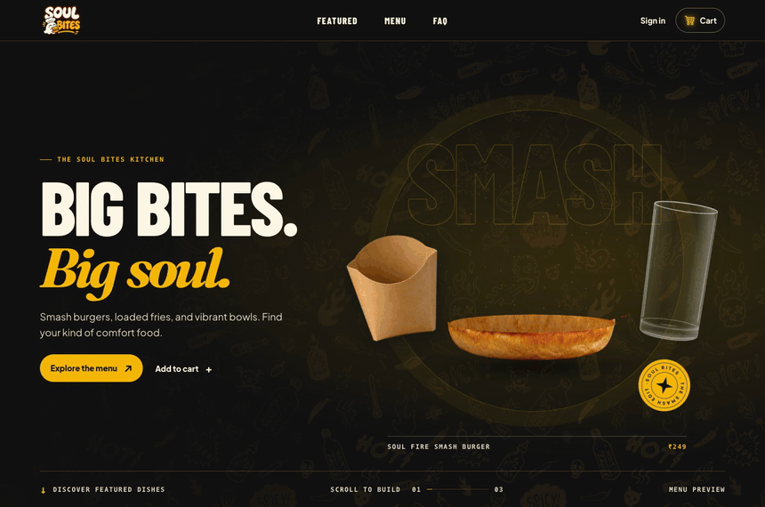
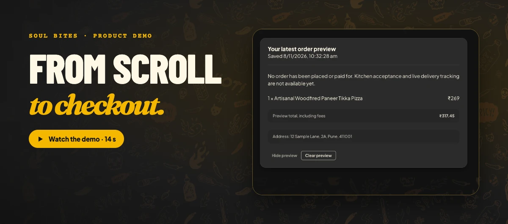
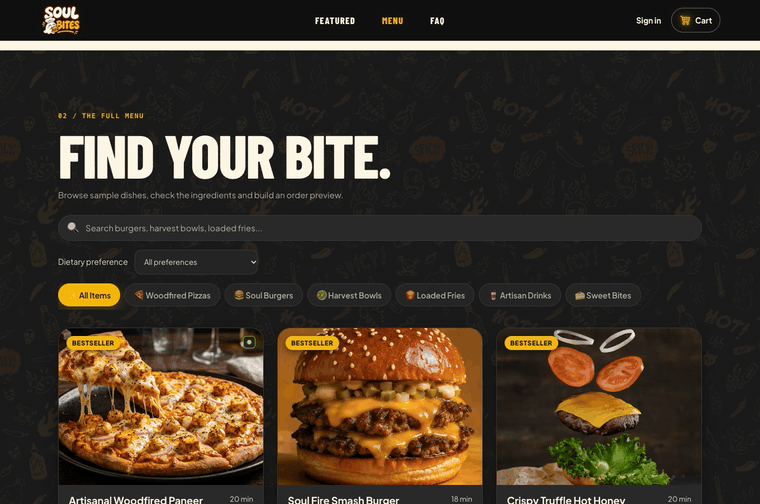
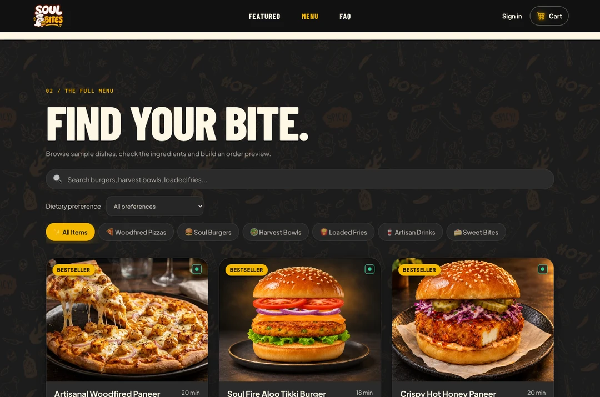
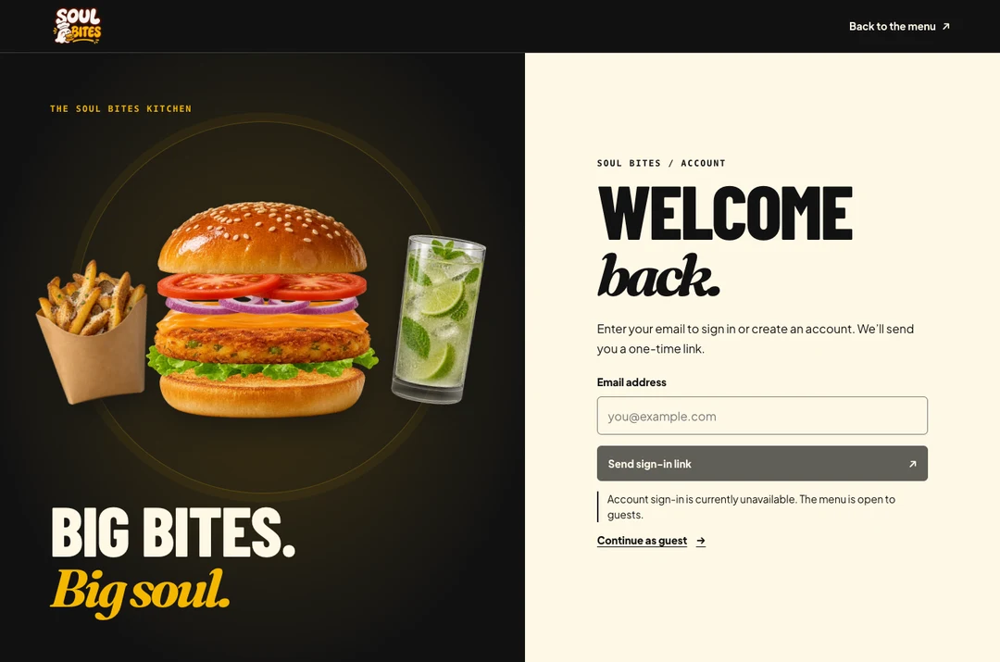
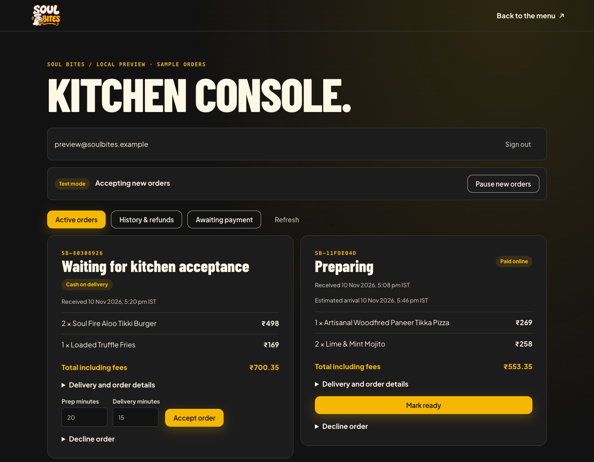

<div align="center">


# Soul Bites

**Big bites. Big soul.**

A vegetarian cloud-kitchen storefront preview. Build a burger with a scroll, find your next bite, and try the menu-to-cart experience.

[](https://github.com/Mxhi-04/Soul-Bites/actions/workflows/ci.yml)


[](LICENSE)

[Try Soul Bites](https://soul-bites.vercel.app/) · [Watch the demo](#watch-the-demo) · [Run locally](#quick-start) · [Launch plan](#launch-on-hostinger)

<picture>
  <source media="(prefers-reduced-motion: reduce)" srcset="docs/showcase/home.webp">
  
</picture>

<sub>The landing scene follows your scroll. The burger ingredients drop into place, fries fall into the pouch, and the mojito fills from above.</sub>

</div>

## What you can try

- **Build the meal.** Scroll to assemble the WebGL aloo tikki burger alongside the mojito and fries, then continue into the featured dish carousel.
- **Find your bite.** Search the sample catalog by dish or ingredient and narrow it by category and dietary preference.
- **Try checkout as a guest.** Add a dish, review the INR totals, and save a sample order to the current browser tab.
- **Explore email sign-in.** A configured Supabase project enables one-time email links. This browser keeps guest and account carts separate.

> [!NOTE]
> Local Vite sessions can save sample orders. The production server enables checkout only after ordering is configured. See the [ordering and launch guide](docs/ORDERING.md).

## Watch the demo

Follow the scroll animation, search for paneer, add a pizza, and save a sample order.

<a href="docs/showcase/soul-bites-demo.mp4"></a>

[Open the demo video (MP4)](docs/showcase/soul-bites-demo.mp4)

<details>
<summary><strong>See the guest checkout as a GIF</strong></summary>



</details>

## Screen gallery

<table>
  <tr>
    <td width="50%" valign="top">
      
      <p><strong>The full menu</strong><br>Search and filter the sample dishes.</p>
    </td>
    <td width="50%" valign="top">
      
      <p><strong>The account page</strong><br>Request a one-time link when Supabase is configured, or continue as a guest.</p>
    </td>
  </tr>
</table>

## Quick start

Use Node.js **22.12 or newer**. CI runs on Node.js 24.

```sh
git clone https://github.com/Mxhi-04/Soul-Bites.git
cd Soul-Bites
npm ci
npm run dev
```

Open [the local site](http://localhost:3000/). Guest browsing, the cart, and order previews work with the default setup.

<details>
<summary><strong>Enable email sign-in</strong></summary>

Add the public Supabase configuration to `.env.local` for development and to the Vercel build environment for deployment.

```dotenv
VITE_SUPABASE_URL=https://YOUR-PROJECT-REF.supabase.co
VITE_SUPABASE_PUBLISHABLE_KEY=sb_publishable_YOUR_KEY
```

Enable the email provider and use the default magic-link template with `{{ .ConfirmationURL }}`. Allow the deployed and local `/login` URLs in Supabase and configure a mail sender for public signup. Open the email link in the same browser that requested it to complete PKCE. [Supabase email setup](https://supabase.com/docs/guides/auth/auth-email-passwordless) · [Publishable keys](https://supabase.com/docs/guides/getting-started/api-keys)

</details>

<details>
<summary><strong>Build and verify</strong></summary>

```sh
npm run check                 # lint, unit tests, and production build
npx playwright install chromium
npm run test:e2e              # production build and desktop/mobile browser tests
npm audit
```

Run `npm run preview` after the production build to serve it locally. Browser checks cover keyboard ordering, dialog accessibility, validation, preview cancellation and recovery, and cart updates across tabs. Set `PLAYWRIGHT_CHROME_PATH` to an absolute Chrome executable path to use an installed browser.

</details>

## Kitchen operations

With ordering configured, staff use `/admin` to accept orders, set preparation and delivery estimates, update status, and reconcile cash or online refunds. To place your own order as a signed-in kitchen owner, choose **Order food** in the console and use the customer checkout. The order appears in the same queue and gets a private tracking link. See the [ordering and launch guide](docs/ORDERING.md) for configuration and go-live checks.



## Launch on Hostinger

**Choose Hostinger Business Web Hosting if Hostinger will run the whole app.** Premium can serve the built storefront, but the kitchen console, customer tracking, checkout, and payment webhooks require the Node.js API. Hostinger lists managed Node.js apps on Business and Cloud plans. [Hostinger Node.js plans](https://www.hostinger.com/support/how-to-deploy-a-nodejs-website-in-hostinger/)

1. **Register `soulbites.in`.** Check availability and renewal pricing in Hostinger, then purchase the domain and a Node.js-capable plan. Use a staging hostname first.
2. **Deploy the production server.** In hPanel, create a **Node.js Web App** from the GitHub repository's `main` branch. If detection selects a static Vite app, choose **Other**. Select Node.js 24, use `npm run build`, set the output directory to `dist`, and set the entry file to `server/start.mjs`. Locally, `npm start` runs that entry after building. [Hostinger deployment guide](https://www.hostinger.com/support/how-to-deploy-a-nodejs-website-in-hostinger/)
3. **Connect Supabase and delivery.** Apply both migrations, configure magic-link email and redirect URLs, and grant the verified owner access to `/admin`. In hPanel, set the build and runtime variables from [the environment template](.env.example). Use the private kitchen coordinates, a 5,000 m radius, and a restricted Google Geocoding key. Confirm actual fees, tax treatment, and service hours before launch. [Ordering guide](docs/ORDERING.md) · [Hostinger environment variables](https://www.hostinger.com/support/how-to-add-environment-variables-during-node-js-application-deployment/)
4. **Test an entire shift in staging.** Keep `COMMERCE_MODE=test`. Place a COD order and a Razorpay test order. Verify payment capture, a full refund, kitchen acceptance, ETA, and cash collection. Try real addresses inside and outside the delivery radius and verify that opening, pausing, and refreshing the kitchen works on a phone.
5. **Connect the production domain and open orders.** Use the DNS records shown in hPanel, verify HTTPS, and set `COMMERCE_ORIGIN=https://soulbites.in` with matching Supabase redirects. Activate the merchant account for the production website, set `COMMERCE_MODE=live`, enable Razorpay with its live keys, and register the production webhook with its own signing secret. Publish the confirmed business, delivery, privacy, and refund details. Start live with the kitchen paused and open it from `/admin` for an operator-supervised first live payment and COD order. [Razorpay go-live checklist](https://razorpay.com/docs/payments/payment-gateway/web-integration/standard/integration-steps/#3-go-live-checklist)

## Under the hood

React and TypeScript power the interface. Vite builds the site, CSS Modules keep component styles local, and the hero uses native scroll progress with a static path for reduced motion.

| Area | Where to start |
| :--- | :--- |
| Meal assembly | [Landing hero](src/features/landing/components/LandingHero.tsx) · [WebGL scene](src/features/landing/services/burgerScene.ts) |
| Catalog and preview pricing | [Sample menu](src/features/menu/services/menuService.ts) · [App configuration](src/constants/config.ts) |
| Cart and checkout | [Cart service](src/features/cart/services/cartService.ts) · [Checkout service](src/features/checkout/services/checkoutService.ts) |
| Account sign-in | [Supabase auth service](src/features/auth/services/authService.ts) |

<details>
<summary><strong>How preview data is stored</strong></summary>

The cart stores product IDs and bounded quantities in local storage. The bundled catalog supplies prices, and open tabs synchronize cart changes. The preview uses a ₹149 minimum subtotal, ₹35 delivery below ₹499, and 5% estimated tax. Delivery fields validate Indian mobile numbers and six-digit PIN codes.

The latest preview lives in session storage for the current tab. Use **Clear preview** to remove it. Cancelling a pending preview preserves the cart. Saving subtracts the previewed quantities and preserves later additions.

</details>

The [project map](docs/PROJECT_MAP.md) and [contributor guide](AGENTS.md) explain the feature boundaries. The [baseline audit](docs/AUDIT.md) and [fixes and launch gaps](docs/FIXES.md) track remediation and the work needed for live fulfillment. The [Vercel configuration](vercel.json) defines SPA routing and security headers.

## License

[MIT](LICENSE) © Mahi Patni. The gallery and demos are captures of the running app. Food artwork is illustrative, and the self-hosted fonts include their [licenses](public/fonts/).

<div align="center"><sub><a href="#soul-bites">Back to top ↑</a></sub></div>
